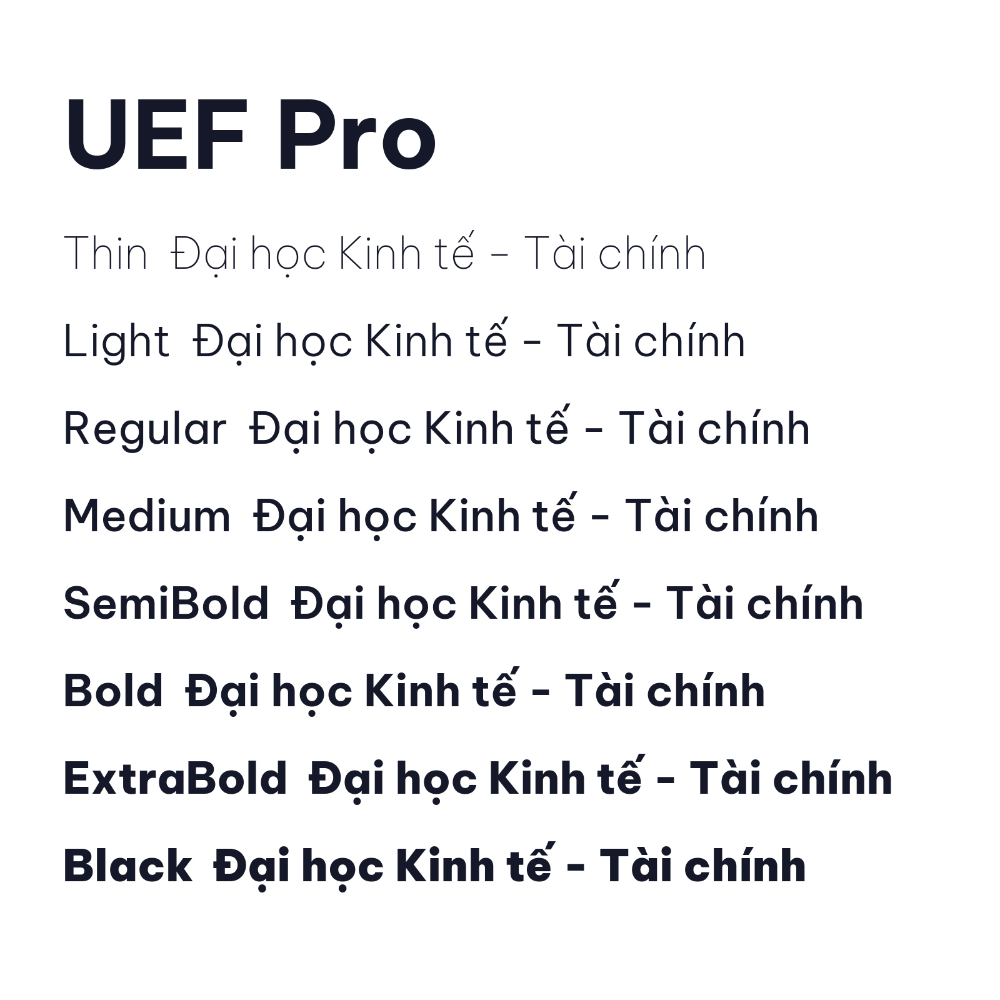
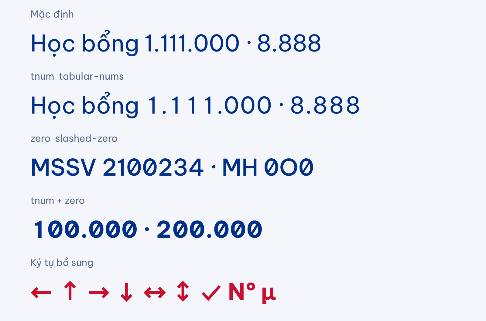

<p align="center">
  <picture>
    <source media="(prefers-color-scheme: dark)" srcset="icons/svg/uef-vi-white.svg">
    
  </picture>
</p>

# UEF Pro Font

**UEF Pro** là bộ font chữ nhận diện của UEF (Trường Đại học Kinh tế - Tài chính TP.HCM), dùng cho website, ứng dụng, tài liệu và ấn phẩm của trường. Font hỗ trợ đầy đủ tiếng Việt với dấu thanh được thiết kế riêng, gồm 9 weight (Thin đến Black) kèm bản nghiêng, cùng 2 variable font.





## Tải font

| Định dạng | Thư mục | Dùng cho |
|---|---|---|
| TTF | [fonts/ttf](fonts/ttf) | Cài lên máy, Office, thiết kế |
| OTF | [fonts/otf](fonts/otf) | Cài lên máy, in ấn |
| Variable TTF | [fonts/variable](fonts/variable) | Web/app cần weight linh hoạt |
| WOFF2 | [fonts/webfonts](fonts/webfonts) | Web |

Dùng trên web:

```css
@font-face {
  font-family: "UEF Pro";
  src: url("UEFPro[wght].woff2") format("woff2");
  font-weight: 100 900;
  font-style: normal;
}
body { font-family: "UEF Pro", system-ui, sans-serif; }
```

## Tính năng OpenType

| Tính năng | CSS | Tác dụng |
|---|---|---|
| `tnum` | `font-variant-numeric: tabular-nums` | Chữ số cùng độ rộng, thẳng cột trong bảng học bổng, điểm, báo cáo tài chính |
| `zero` | `font-variant-numeric: slashed-zero` | Số 0 gạch chéo, phân biệt với chữ O (mã sinh viên, mã môn học) |
| `ss01` | `font-feature-settings: "ss01"` | Chữ a một tầng |
| `frac`, `sups`, `subs`, `numr`, `dnom`, `ordn`, `case` | `font-variant-numeric`, `font-variant-caps`... | Phân số, chỉ số trên/dưới, số thứ tự, dấu theo chữ hoa |

```css
table td.so { font-variant-numeric: tabular-nums slashed-zero; }
```



Ký tự bổ sung so với Be Vietnam Pro: mũi tên ← ↑ → ↓ ↔ ↕, dấu ✓, №, μ (U+03BC) và dấu nối không ngắt dòng (U+2011).

## Build font

1. Cài ttfautohint: `brew install ttfautohint`
2. Tạo môi trường và cài gftools:
   ```
   python3 -m venv env
   source env/bin/activate
   pip install gftools
   ```
3. Build:
   ```
   cd sources
   gftools builder config.yaml
   ```

Nguồn font nằm ở [sources/](sources): `UEFPro.glyphs` và `UEFPro-Italic.glyphs`.

CI (GitHub Actions) tự build và chạy Fontbakery mỗi khi push hoặc mở pull request, xem [.github/workflows/build.yaml](.github/workflows/build.yaml).

## UEF Pro Icons (logo và badge sản phẩm)

Font phụ [UEFProIcons-Regular](fonts/icons) chứa logo UEF và badge tên sản phẩm, dùng chung với UEF Pro. Xem thử tại [icons/specimen.html](icons/specimen.html). Ảnh dưới đây là bản SVG của cùng các glyph (GitHub không hiển thị font tuỳ biến nên README dùng SVG).

| Hiển thị | Mã | Nội dung | SVG |
|---|---|---|---|
|  | U+E000 / U+E100 | Logo kèm tên trường tiếng Việt (đơn sắc / màu) | [uef-vi-color.svg](icons/svg/uef-vi-color.svg) |
|  | U+E001 / U+E101 | Logo kèm tên trường tiếng Anh (đơn sắc / màu) | [uef-en-color.svg](icons/svg/uef-en-color.svg) |
|  | U+E002 / U+E102 | Biểu tượng + chữ UEF, không kèm tên trường | [uef-mark-color.svg](icons/svg/uef-mark-color.svg) |
|  | U+E010 | Badge UEF ID | [badge-uef-id.svg](icons/svg/badge-uef-id.svg) |
|  | U+E011 | Badge LMS | [badge-lms.svg](icons/svg/badge-lms.svg) |
|  | U+E012 | Badge Workplace | [badge-workplace.svg](icons/svg/badge-workplace.svg) |

Bản trắng cho nền tối: [tiếng Việt](icons/svg/uef-vi-white.svg), [tiếng Anh](icons/svg/uef-en-white.svg).

```css
@font-face { font-family: "UEF Pro Icons"; src: url("UEFProIcons-Regular.woff2") format("woff2"); }
.uef-icon { font-family: "UEF Pro Icons"; }
```
```html
<span class="uef-icon" role="img" aria-label="UEF ID">&#xE010;</span>
```

Build lại: `python icons/build_icons.py`, rồi `python icons/export_svgs.py` để xuất SVG (cần `fonttools` và `skia-pathops`). Nguồn logo ở [icons/svg](icons/svg). Logo UEF là nhãn hiệu của UEF; chỉ dùng theo quy định nhận diện thương hiệu của trường.

## Tài liệu

- [Đánh giá đưa logo UEF và icon sản phẩm (UEF ID, LMS, Workplace) vào font](documentation/UEF-ICONS-FEASIBILITY.md)

## Giấy phép

Phát hành theo [SIL Open Font License 1.1](OFL.txt).

---

UEF Pro là bản fork từ [Be Vietnam Pro](https://github.com/bettergui/BeVietnamPro) của Be Vietnam Pro Project Authors (Lam Bao, Tony Le, Vietanh Nguyen; Yellow Type Foundry), theo giấy phép OFL 1.1.
